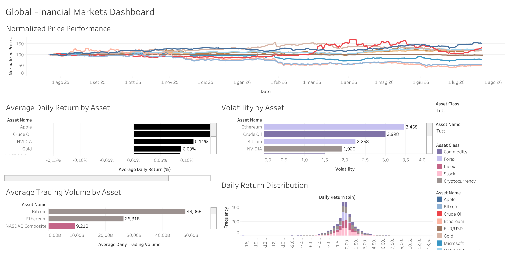

# Global Financial Markets Dashboard

An end-to-end Data Analytics project that automatically collects, processes, stores, analyzes, and visualizes global financial market data.

The project demonstrates a complete ETL (Extract, Transform, Load) pipeline built with Python, SQLite, SQL, and Tableau, following industry best practices for data analytics projects.

---
## 📊 Live Dashboard

**View the interactive dashboard on Tableau Public:**
s**[Open the Interactive Tableau Dashboard](https://public.tableau.com/views/GlobalFinancialMarketsDashboard/Dashboard)**

# Dashboard Preview


---

# Project Overview

This project automatically downloads daily financial market data from Yahoo Finance, cleans and transforms the data, stores it in a SQLite database, performs SQL analysis, and visualizes key market insights using Tableau.

The dashboard allows users to compare the performance of major financial assets including:

- Stock Market Indices
- Technology Stocks
- Cryptocurrencies
- Commodities
- Foreign Exchange

Assets included:

- S&P 500
- NASDAQ Composite
- Apple
- Microsoft
- NVIDIA
- Bitcoin
- Ethereum
- Gold
- Crude Oil
- EUR/USD

---

# Project Architecture

```
               Yahoo Finance API
                      │
                      ▼
             Data Extraction (Python)
                      │
                      ▼
             Data Cleaning & Validation (pandas)
                      │
                      ▼
             SQLite Database Storage
                      │
                      ▼
                SQL Analysis
                      │
                      ▼
            Tableau Dashboard
```

---

# Technologies Used

| Category | Technologies |
|----------|--------------|
| Programming | Python |
| Data Processing | Pandas |
| Financial Data | Yahoo Finance (yfinance) |
| Database | SQLite |
| Query Language | SQL |
| Visualization | Tableau Public |
| IDE | VS Code |
| Version Control | Git & GitHub |

---

# Project Structure

```text
Global-Financial-Markets-Dashboard/
│
├── data/
│   ├── raw/
│   ├── processed/
│   └── database/
│
├── notebooks/
│   ├── 01_ETL_Pipeline.ipynb
│   └── 02_SQL_Analysis.ipynb
│
├── sql/
│   └── analysis_queries.sql
│
├── src/
│   ├── extract/
│   │   └── data_extractor.py
│   ├── transform/
│   │   └── data_transformer.py
│   └── load/
│       └── data_loader.py
│
├── tableau/
│
├── README.md
├── requirements.txt
└── main.py
```

---

# ETL Pipeline

## Extract

- Downloads historical market data
- Retrieves data for multiple asset classes
- Uses Yahoo Finance API

## Transform

The transformation stage performs:

- Data cleaning
- Duplicate removal
- Missing value validation
- Daily return calculation
- Price normalization
- Asset classification
- Asset name mapping

## Load

Processed data is exported to:

- CSV
- SQLite Database

---

# SQL Analysis

The project includes SQL queries for:

- Best performing assets
- Worst performing assets
- Highest trading volume
- Average daily returns
- Asset class comparison
- Market statistics

---

# Tableau Dashboard

The interactive dashboard provides:

- Asset performance comparison
- Normalized price trends
- Daily returns
- Asset class distribution
- Interactive filters
- KPI cards

---

# Results

The project successfully demonstrates:

- Automated ETL pipeline
- Financial data processing
- Feature engineering
- SQL database management
- Data analysis using SQL
- Interactive business intelligence dashboard

---

# Future Improvements

- Automated daily data refresh
- Logging system
- Configuration file (.env)
- Unit testing
- Docker containerization
- Cloud database support
- GitHub Actions automation
- Additional financial indicators
- Portfolio optimization metrics
- Risk analysis

---

# Author

**Maria Murziankova**

Economics & Finance Student | Data Analytics | Business Intelligence


## Connect with Me

[](https://github.com/murziankovamaria-dotcom)

[](https://www.linkedin.com/in/maria-murziankova-004522327/)

[](https://public.tableau.com/app/profile/maria.murziankova/vizzes)